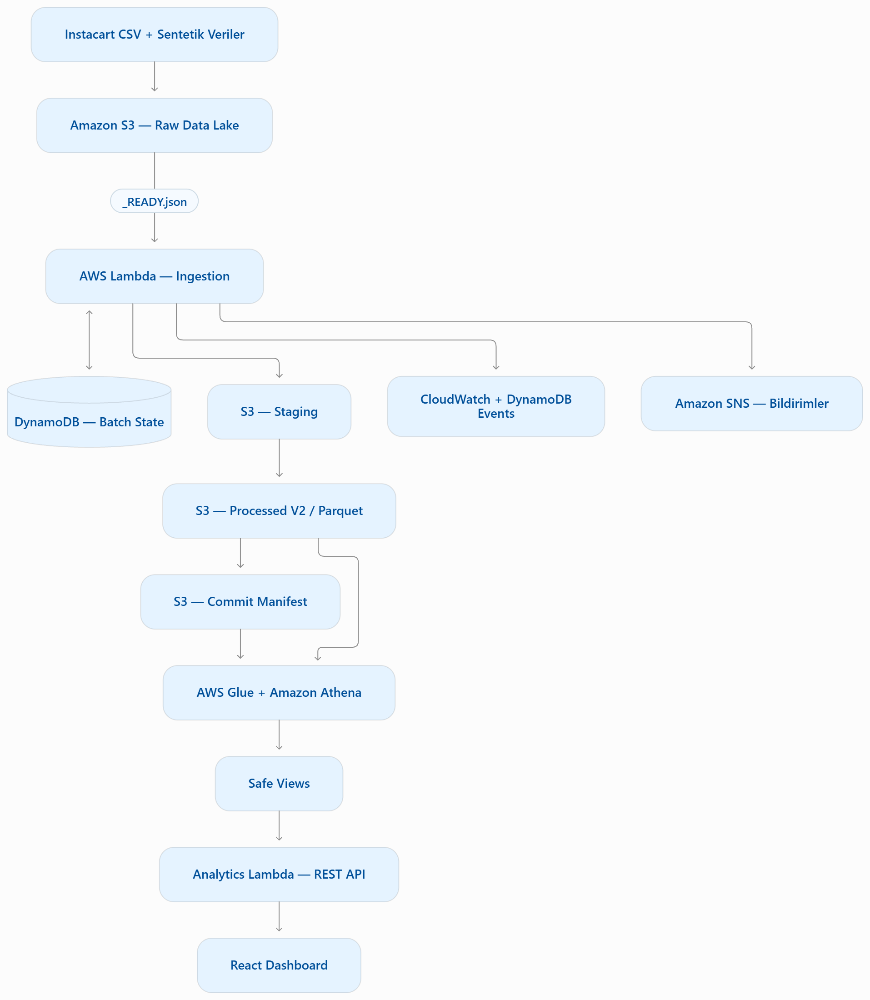
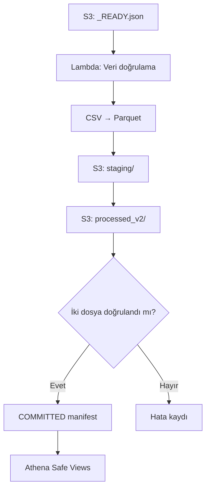

# Instacart E-Commerce Analytics Platform

## 1. Proje Özeti

Bu projede, Instacart e-ticaret veri seti kullanılarak **AWS üzerinde sunucusuz (serverless) bir veri işleme ve analitik platformu** geliştirilmiştir.

Sistem, sipariş verilerini Amazon S3 üzerinde depolar, AWS Lambda ile doğrular ve Parquet formatına dönüştürür. İşlenen veriler Amazon Athena üzerinden sorgulanır ve React tabanlı web arayüzünde grafikler, KPI kartları ve filtrelenebilir tablolarla sunulur.

## 2. Projenin Amacı

Projenin amacı, büyük hacimli e-ticaret verilerini **güvenilir, ölçeklenebilir ve maliyet odaklı** bir mimariyle işlemek ve analiz edilebilir hâle getirmektir.

Temel yetenekler:

- Artımlı veri yükleme (**incremental batch ingestion**)
- SHA-256 ile dosya ve veri bütünlüğü doğrulaması
- DynamoDB ile tekrarlı işlemeyi önleme (**idempotency**)
- Parquet tabanlı analitik depolama
- Parametrik SQL sorguları ve REST API
- Filtrelenebilir, grafik destekli e-ticaret dashboard'u
- CloudWatch, DynamoDB ve SNS üzerinden olay izleme ve bildirim

## 3. Veri Seti ve Hazırlık

Kaynak olarak **Instacart Market Basket Analysis** veri seti kullanılmıştır. Siparişler, müşteriler, ürünler ve ürün kategorileri arasındaki ilişkiler analizin temelini oluşturur.

| Özellik | Açıklama |
|---|---|
| Kaynak formatı | CSV |
| Kaynak dosya sayısı | 6 |
| Başlangıç veri boyutu | Yaklaşık 713 MB |
| Yükleme modeli | Batch tabanlı |
| İşlenmiş veri formatı | Parquet |
| Eklenen alanlar | Sentetik ürün fiyatları ve sipariş tarihleri |

**Veri sınırlaması:** Kaynak veri gerçek ürün fiyatlarını ve kesin sipariş tarihlerini içermediği için bu alanlar proje kapsamında sentetik olarak oluşturulmuştur. Gelir metrikleri gerçek Instacart cirosunu temsil etmez.

## 4. Sistem Mimarisi



### 4.1. Veri akışı

1. **Veri yükleme:** Sipariş CSV dosyaları S3'e yüklenir; `_READY.json` işleme sinyali olarak kullanılır.
2. **Doğrulama ve dönüşüm:** Ingestion Lambda dosya bütünlüğünü ve kayıtları doğrular, ardından CSV'leri Parquet'e dönüştürür.
3. **Güvenli yayımlama:** İki Parquet dosyası hazırlanıp kontrol edildikten sonra commit manifesti yazılır.
4. **Analitik sorgular:** Athena, commit edilmiş batch'leri `orders_safe` ve `order_items_safe` görünümleri üzerinden sorgular.
5. **Sunum:** Analytics Lambda REST API yanıtlarını üretir; React dashboard KPI ve grafiklerle verileri gösterir.

### 4.2. Kullanılan teknolojiler

| Katman | Teknolojiler |
|---|---|
| Veri depolama | Amazon S3, Parquet |
| Veri işleme | AWS Lambda, Python |
| Veri kataloğu ve SQL | AWS Glue Data Catalog, Amazon Athena |
| Durum ve olay kaydı | Amazon DynamoDB, Amazon CloudWatch |
| Bildirim | Amazon SNS |
| API dağıtımı | Docker, Amazon ECR, AWS CodeBuild, Lambda Function URL |
| Web arayüzü | React, TypeScript, Vite, S3 Static Website Hosting |

---

## 5. S3 Data Lake ve Batch Yapısı

### 5.1. S3 Veri Gölü Organizasyonu

Projede Amazon S3, ham verilerin ve işlenmiş analitik verilerin saklandığı merkezi veri gölü (Data Lake) olarak kullanılmaktadır.

Veriler, işleme aşamalarına göre farklı dizinlerde tutulmaktadır. Böylece kaynak dosyalar korunurken işlenmiş veriler ve batch kontrol kayıtları birbirinden ayrılmaktadır.

```text
instacart-ecom-data-raw/
│
├── raw/
│   ├── reference/              # Referans veriler
│   └── batches/                # CSV batch dosyaları
│       └── batch_0015/
│           ├── orders.csv
│           ├── order_items.csv
│           └── _READY.json
│
├── processed/                   # İlk 14 batch (eski yapı)
│   ├── orders/
│   └── order_items/
│
├── staging/                     # Geçici Parquet çıktıları
│
├── processed_v2/                # Yeni Parquet yapısı
│   ├── orders/
│   │   └── batch_0015.parquet
│   └── order_items/
│       └── batch_0015.parquet
│
└── control/
    └── commits/
        └── batch_0015.json
```

### 5.2. Batch Tabanlı Veri Yükleme

Veri seti, günlük veri akışını simüle etmek amacıyla batch dosyalarına ayrılmıştır.

Her batch iki CSV dosyası ve bir kontrol dosyası içerir:

| Dosya | Görevi |
|---|---|
| `orders.csv` | Sipariş ve müşteri bilgileri |
| `order_items.csv` | Siparişlerdeki ürün bilgileri |
| `_READY.json` | Batch doğrulama bilgilerini ve işleme sinyalini içerir |

Normal yükleme sürecinde önce CSV dosyaları, ardından `_READY.json` yüklenir.

S3 üzerinde `_READY.json` oluşturulduğunda AWS Lambda otomatik olarak tetiklenir.

### 5.3. Veri Bütünlüğü ve Commit Mekanizması

İlk tasarımda Lambda, Parquet dosyalarını doğrudan `processed/` dizinine yazmaktaydı. Bu yaklaşımda dosyalardan biri başarıyla yazılırken diğerinin başarısız olması, eksik batch verilerinin analitik sorgulara yansıması riskini oluşturuyordu.

Bu nedenle sistem, **staging ve commit tabanlı yeni bir yapıya** geçirilmiştir.



İki Parquet dosyası başarıyla oluşturulup doğrulandıktan sonra `control/commits/` altında bir JSON manifesti yazılır.

Athena üzerindeki `orders_safe` ve `order_items_safe` görünümleri, yeni mimaride yalnızca `COMMITTED` durumundaki batch'leri sorgular. İlk 14 batch ise eski tablolardan okunmaya devam eder.

Bu mekanizma, eksik batch'lerin analitik sonuçlarda görünmesini önlemeyi amaçlar. Ancak tam ACID transaction garantisi sağlamaz.


6. **Ingestion Pipeline ve Veri Doğrulama**  
7. **Idempotency, Commit Mekanizması ve Hata Yönetimi**  
8. **Athena Analitiği ve API Endpoint'leri**  
9. **React Dashboard**  
10. **İzleme, Güvenlik ve Testler**  
11. **Performans, AWS Maliyetleri ve Sınırlamalar**  
12. **Sonuç ve Gelecek Geliştirmeler**
