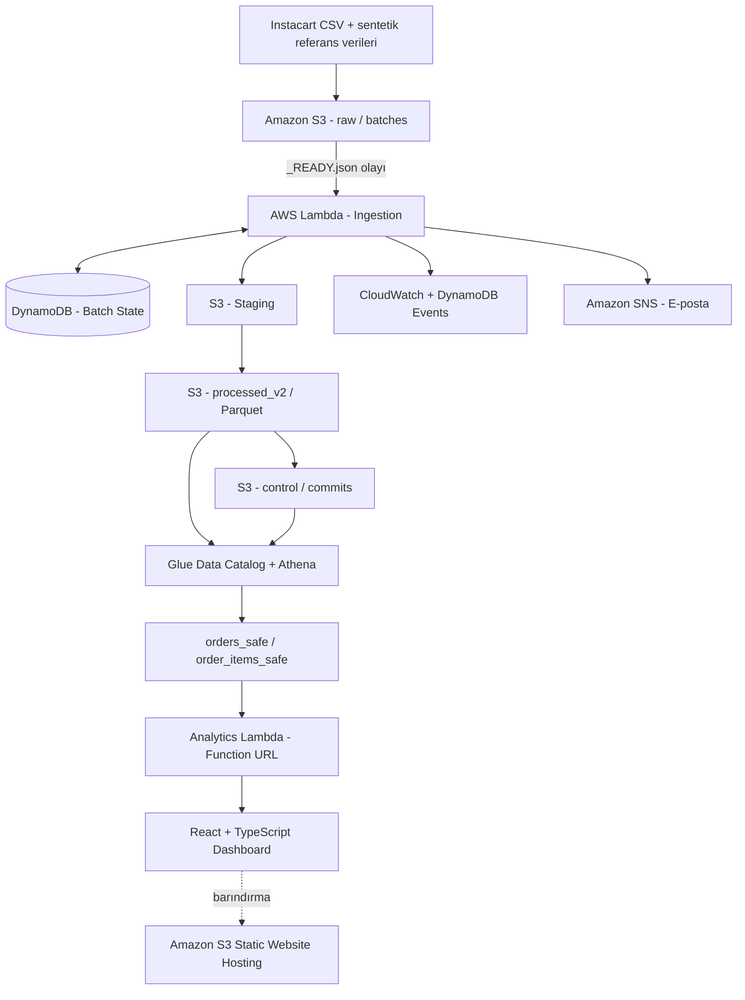

# Instacart E-Commerce Analytics Platform

## 1. Proje Özeti

Bu projede, Instacart e-ticaret veri seti kullanılarak **AWS üzerinde sunucusuz (serverless) bir veri işleme ve analitik platformu** geliştirilmiştir.

Sistem, sipariş verilerini Amazon S3 üzerinde depolar, AWS Lambda ile doğrular ve Parquet formatına dönüştürür. İşlenen veriler Amazon Athena üzerinden sorgulanır ve React tabanlı web arayüzünde grafikler, KPI kartları ve filtrelenebilir tablolarla sunulur.

## 2. Projenin Amacı

Projenin amacı, büyük hacimli e-ticaret verilerini **güvenilir, ölçeklenebilir ve maliyet odaklı** bir mimariyle işlemek ve analiz edilebilir hâle getirmektir.

Temel yetenekler:

- Artımlı veri yükleme (**incremental batch ingestion**)
- SHA-256 ile dosya ve veri bütünlüğü doğrulaması
- DynamoDB ile tekrarlı işlemeyi önleme (**idempotency**)
- Parquet tabanlı analitik depolama
- Parametrik SQL sorguları ve REST API
- Filtrelenebilir, grafik destekli e-ticaret dashboard'u
- CloudWatch, DynamoDB ve SNS üzerinden olay izleme ve bildirim

## 3. Veri Seti ve Hazırlık

Kaynak olarak **Instacart Market Basket Analysis** veri seti kullanılmıştır. Siparişler, müşteriler, ürünler ve ürün kategorileri arasındaki ilişkiler analizin temelini oluşturur.

| Özellik | Açıklama |
|---|---|
| Kaynak formatı | CSV |
| Kaynak dosya sayısı | 6 |
| Başlangıç veri boyutu | Yaklaşık 713 MB |
| Yükleme modeli | Batch tabanlı |
| İşlenmiş veri formatı | Parquet |
| Eklenen alanlar | Sentetik ürün fiyatları ve sipariş tarihleri |

**Veri sınırlaması:** Kaynak veri gerçek ürün fiyatlarını ve kesin sipariş tarihlerini içermediği için bu alanlar proje kapsamında sentetik olarak oluşturulmuştur. Gelir metrikleri gerçek Instacart cirosunu temsil etmez.

## 4. Sistem Mimarisi

### 4.1. Veri akışı

1. **Veri yükleme:** Sipariş CSV dosyaları S3'e yüklenir; `_READY.json` işleme sinyali olarak kullanılır.
2. **Doğrulama ve dönüşüm:** Ingestion Lambda dosya bütünlüğünü ve kayıtları doğrular, ardından CSV'leri Parquet'e dönüştürür.
3. **Güvenli yayımlama:** İki Parquet dosyası hazırlanıp kontrol edildikten sonra commit manifesti yazılır.
4. **Analitik sorgular:** Athena, commit edilmiş batch'leri `orders_safe` ve `order_items_safe` görünümleri üzerinden sorgular.
5. **Sunum:** Analytics Lambda REST API yanıtlarını üretir; React dashboard KPI ve grafiklerle verileri gösterir.

### 4.2. Kullanılan teknolojiler

| Katman | Teknolojiler |
|---|---|
| Veri depolama | Amazon S3, Parquet |
| Veri işleme | AWS Lambda, Python |
| Veri kataloğu ve SQL | AWS Glue Data Catalog, Amazon Athena |
| Durum ve olay kaydı | Amazon DynamoDB, Amazon CloudWatch |
| Bildirim | Amazon SNS |
| API dağıtımı | Docker, Amazon ECR, AWS CodeBuild, Lambda Function URL |
| Web arayüzü | React, TypeScript, Vite, S3 Static Website Hosting |

> **Tasarım notu:** Commit manifesti ve safe view yaklaşımı, eksik batch'lerin analitik sorgularda görünmesini önlemeyi hedefler. Bu mekanizma tam bir çok-tablolu ACID transaction değildir.

---

## Sonraki bölümler (plan)

5. **S3 Data Lake ve Batch Yapısı**  
6. **Ingestion Pipeline ve Veri Doğrulama**  
7. **Idempotency, Commit Mekanizması ve Hata Yönetimi**  
8. **Athena Analitiği ve API Endpoint'leri**  
9. **React Dashboard**  
10. **İzleme, Güvenlik ve Testler**  
11. **Performans, AWS Maliyetleri ve Sınırlamalar**  
12. **Sonuç ve Gelecek Geliştirmeler**
